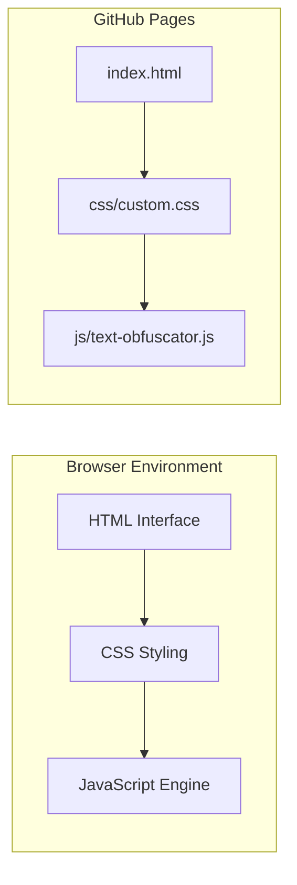
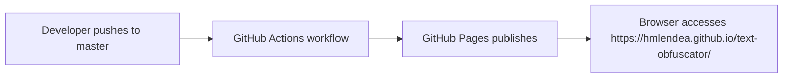

# Text Obfuscator Architecture

## 📑 Table of Contents

- [Purpose](#purpose)
- [System Context](#system-context)
- [Architectural Style](#architectural-style)
- [Runtime Flow](#runtime-flow)
- [Components](#components)
- [Data Architecture](#data-architecture)
- [Interfaces and Integrations](#interfaces-and-integrations)
- [Key Flows](#key-flows)
- [Dependency Direction and Rules](#dependency-direction-and-rules)
- [External Dependencies](#external-dependencies)
- [Deployment and Operations](#deployment-and-operations)
- [Compatibility Contracts](#compatibility-contracts)
- [Testing and Verification](#testing-and-verification)

## 🎯 Purpose

This document describes the architecture of the Text Obfuscator project, a client-side JavaScript tool that runs in the browser to replace characters in text with random Unicode equivalents. The system is designed for developers to obfuscate text for various purposes. This architecture document captures the current implementation rather than a proposed design.

## 🌐 System Context

The Text Obfuscator is a static web application hosted on GitHub Pages. It runs entirely within the user's browser and does not communicate with any external services or transmit data beyond the browser environment.

**System boundary:** The web application (HTML, CSS, JavaScript) running in the browser, including all assets served from the repository.

**Actors:**
- **End user:** Provides input text and receives obfuscated output through the web interface.

**External systems:**
- **GitHub Pages:** Hosts the static web application.
- **Web browser:** Executes the JavaScript code and renders the HTML/CSS interface.

**Data stores:** None — no data is persisted; all processing is transient.

**Trust boundaries:** The entire application operates within a single trust boundary (the browser); no data is transmitted to external servers.



## 🏗️ Architectural Style

The project follows a **client-side static web application** architectural style with the following characteristics:

- **Single-page application:** The interface consists of a single HTML page with interactive elements.
- **Unidirectional data flow:** User input → JavaScript processing → Display output.
- **No external dependencies:** The application uses only standard web technologies (HTML, CSS, JavaScript) and third‑party libraries via CDN (jQuery, Bootstrap, Font Awesome, Google Fonts).
- **Composition root:** The `index.html` file serves as the entry point that composes all components.

**Consequences:**
- All processing occurs client‑side; no server deployment is required.
- The application can be hosted on any static file hosting service.
- Changes to the JavaScript logic require a page reload to take effect.

## 🔄 Runtime Flow

The principal runtime sequence is:

1. **Page load:** `index.html` is loaded by the browser, including CSS styling and JavaScript.
2. **Initialisation:** DOM elements are rendered; event listeners are attached.
3. **User interaction:** User enters text in the input field and clicks the "Obfuscate" button, or toggles the "Approximate characters" checkbox.
4. **Processing:** The `obfuscateText()` function iterates through each character of the input, applying replacements from the `identicalReplacements` and `approximateReplacements` maps.
5. **Output display:** The obfuscated text is populated into the output field, which is disabled (read‑only).
6. **Copy functionality:** User can click the "Copy" button to copy the obfuscated text to the clipboard.

```mermaid
flowchart TD
    A[User loads page] --> B[DOM rendered]
    B --> C[User enters text]
    C --> D[Click "Obfuscate"]
    D --> E[obfuscateText() runs]
    E --> F[Replace characters using replacement maps]
    F --> G[Display obfuscated text]
    G --> H[User copies or closes]
```

## 🧩 Components

| Component | Responsibility | Principal Dependencies | Lifetime or Ownership |
|-----------|----------------|------------------------|-----------------------|
| `index.html` | Defines the web page structure, input/output fields, and UI controls | Bootstrap CSS, Font Awesome icons, jQuery | Loaded on each page visit; static asset |
| `css/custom.css` | Provides custom styling for the obfuscator interface | None (pure presentation) | |
| `js/text-obfuscator.js` | Contains the obfuscation logic, character replacement maps, and the `obfuscateText()` function | None (pure logic) | |

## 💾 Data Architecture

The application does not own, transform, cache, transmit, or persist meaningful state. All processing is transient and occurs only during a single obfuscation session.

**Key characteristics:**
- No data models or stores are defined.
- No persistence layer exists — obfuscated text is displayed and not saved.
- No cache or retention policies apply.
- The only "data" is the text provided by the user in the browser interface.

## 🔌 Interfaces and Integrations

The application has the following verified interfaces:

| Interface or Integration | Direction | Contract | Owner | Failure Semantics |
|--------------------------|-----------|----------|-------|-------------------|
| `index.html` (HTML interface) | Inbound | HTML form with input field, output field, and buttons | `horatiu` (maintainer) | If HTML is malformed, the page fails to render correctly |
| `js/text-obfuscator.js` (obfuscation logic) | Inbound | JavaScript function `obfuscateText()` with no parameters; reads from DOM, writes to DOM | `horatiu` (maintainer) | If JavaScript errors occur, obfuscation does not run and output remains unchanged |
| Bootstrap CDN | Inbound | CSS/JS library for styling and UI components | Third-party (Bootstrap) | If CDN is unavailable, styling degrades but functionality remains |
| Font Awesome CDN | Inbound | Icon font library | Third-party (Font Awesome) | If CDN is unavailable, icons may not display but functionality remains |
| jQuery CDN | Inbound | JavaScript library for DOM manipulation | Third-party (jQuery) | If CDN is unavailable, some UI interactions may fail |

## 🚀 Deployment and Operations

The Text Obfuscator is deployed as a **static web application** on GitHub Pages.

**Process topology:**
- Single process: the web browser rendering the static files.
- No server processes, background workers, or services are required.

**Deployment model:**
- Single process: the web browser rendering the static files.
- Updates are deployed by pushing changes to the `master` branch.
- Rollbacks are performed by reverting to a previous commit.
- Monitoring is not required as no external services or data are involved.

**Operational consequences:**
- Updates are deployed by pushing changes to the `master` branch.
- Rollbacks are performed by reverting to a previous commit.
- No monitoring is required as no external services or data are involved.



## 🛡️ Compatibility Contracts

The application maintains compatibility for the following contracts:

| Contract | Owner | Invariant | Verification | Change Policy |
|----------|-------|-----------|--------------|---------------|
| HTML structure | `horatiu` | `<input>` elements with IDs `input` and `output`; button with ID `obfuscate` | Manual verification by inspecting `index.html` | Changes to structure require corresponding JavaScript updates |
| JavaScript API | `horatiu` | `obfuscateText()` function exists and operates on DOM elements | Manual testing in browser | New functions may be added; existing function signature must not change |
| CSS class names | `horatiu` | `form-control`, `form-switch`, `btn`, `navbar-*` classes used for styling | Manual verification | Classes may be extended but existing classes must be preserved |
| URL structure | `horatiu` | Application accessible at `https://hmlendea.github.io/text-obfuscator/` | Manual verification | Path structure must not change; new routes may be added |

## ✅ Testing and Verification

The project does not have an automated test suite. Verification is performed manually:

**Manual testing steps:**
1. Open the application at `https://hmlendea.github.io/text-obfuscator/`.
2. Enter text in the input field.
3. Click "Obfuscate" and verify the output field contains obfuscated text.
4. Toggle "Approximate characters" checkbox and verify additional character replacements are applied.
5. Click "Copy" and verify the obfuscated text is copied to the clipboard.
6. Test with various input types: empty text, special characters, long text, Unicode text.

**Material coverage gaps or explicit test constraints:**
- No unit tests exist for the obfuscation logic.
- No integration tests exist.
- No test coverage reports are generated.
- Edge cases (e.g., very long input, surrogate pairs, emoji) are not systematically tested.

**Executable verification commands:** None — the project has no build, test, or verification scripts beyond manual browser testing.

## 📄 References

- [CODE_OF_CONDUCT.md](CODE_OF_CONDUCT.md)
- [PRIVACY.md](PRIVACY.md)
- [CONTRIBUTING.md](CONTRIBUTING.md)
- [SECURITY.md](SECURITY.md)
- [index.html](index.html)
- [js/text-obfuscator.js](js/text-obfuscator.js)
- [css/custom.css](css/custom.css)

---

*Architecture Document – Text Obfuscator*
*Generated for the Text Obfuscator project (hmlendea/text-obfuscator)*
*Last updated: 2026-04-10*
