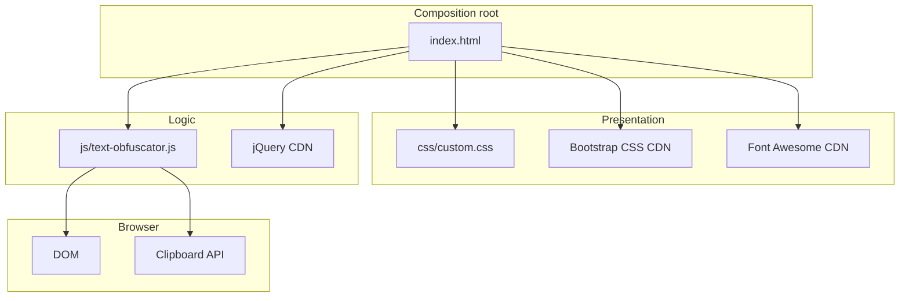
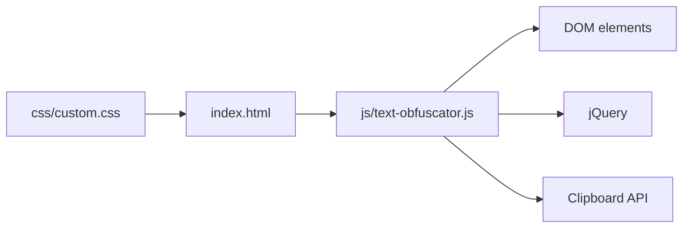

# Architecture

This document complements the root [ARCHITECTURE.md](../ARCHITECTURE.md) with implementation-level detail. It does not duplicate the root document; it elaborates on component interactions, data transformations, and causal dependencies.

## Architectural style

Client-side static web application. Single HTML page composes all components. Unidirectional data flow: user input, JavaScript processing, display output.

## Component decomposition

## Runtime topology

Single process: the web browser rendering static files. No server processes, background workers, or services. All processing occurs within the browser trust boundary.

## Principal capabilities

1. **Identical character replacement** — Replace characters with visually identical Unicode equivalents using `identicalReplacements` and `identicalGroupReplacements`.
2. **Approximate character replacement** — Optionally replace characters with visually similar but not identical equivalents using `approximateReplacements` and `approximateGroupReplacements`.
3. **Zero-width space insertion** — Optionally insert random zero-width characters at random positions in the output.
4. **Clipboard copy** — Copy obfuscated output to the clipboard with fallback.

## Dependency direction

Dependencies flow inward toward `js/text-obfuscator.js`. The JavaScript module depends on DOM element IDs defined in `index.html` and on jQuery loaded from CDN. No reverse dependencies exist.

## System-wide invariants

- All processing occurs client-side; no data leaves the browser.
- The output field is read-only; users cannot edit obfuscated output directly.
- Replacement maps are static; they are defined at script load time and never mutated.
- Random selection uses `Math.random()`; results are non-deterministic across invocations.
- Zero-width space insertion operates on the output string after character replacement.

## Major state

The application owns no persistent state. Transient state exists only in:
- DOM input field value (`#input`)
- DOM output field value (`#output`)
- Checkbox states (`#approximateCharactersCheckbox`, `#zeroWidthSpacesCheckbox`)
- Local variables within `obfuscateText()` during execution

## Major integrations

- jQuery CDN (DOM manipulation)
- Bootstrap CDN (styling and components)
- Font Awesome CDN (icons)
- Google Fonts CDN (typography)
- Start Bootstrap Freelancer template CDN (additional styling and scripts)

## Extension points

- Add entries to `identicalReplacements`, `approximateReplacements`, `identicalGroupReplacements`, or `approximateGroupReplacements` to extend obfuscation coverage.
- Add new checkboxes in `index.html` and read their state in `obfuscateText()` to add options.
- Replace `copyText()` implementation to support additional clipboard mechanisms.

## Failure semantics

- If jQuery fails to load, `$` is undefined and `obfuscateText()` throws when called.
- If DOM element IDs change without corresponding JavaScript updates, `obfuscateText()` reads undefined values.
- If `navigator.clipboard` is unavailable or the context is insecure, `fallbackCopy()` executes.
- If `document.execCommand("copy")` is unsupported, copy silently fails.

## References

- Root architecture: [ARCHITECTURE.md](../ARCHITECTURE.md)
- Components: [components/](./components/)
- Flows: [flows/](./flows/)
- Invariants: [invariants.md](./invariants.md)