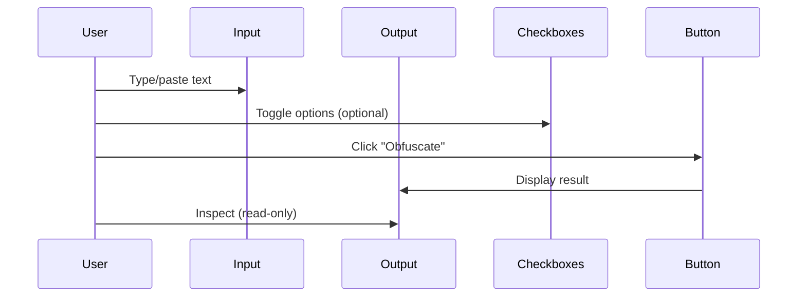
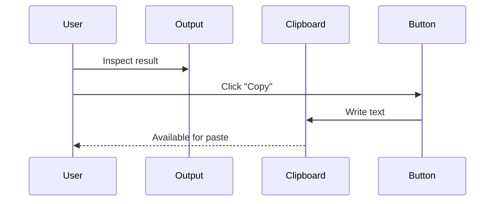
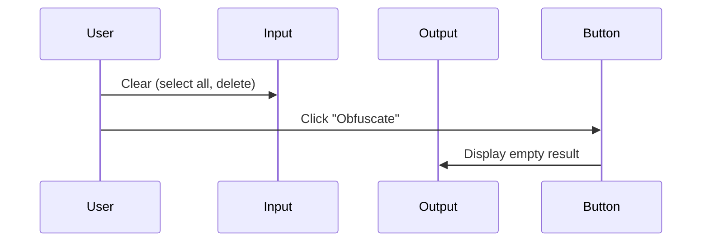

# Inspect, edit, delete

## User interactions

The application supports three primary user interactions with the text data:

### Inspect (read)

| Element | Action | Result |
|---------|--------|--------|
| `#input` | Type/paste text | Text appears in input field |
| `#output` | View result | Obfuscated text displayed (readonly) |
| Checkboxes | View state | Visual checked/unchecked indication |

### Edit (write)

| Element | Action | Constraints |
|---------|--------|-------------|
| `#input` | Type, paste, cut, delete | Single line only; no newline support |
| `#approximateCharactersCheckbox` | Click/toggle | Boolean; affects obfuscation algorithm |
| `#zeroWidthSpacesCheckbox` | Click/toggle | Boolean; affects zero-width insertion |

**Note**: `#output` has `readonly` attribute — cannot be edited directly.

### Delete (clear)

| Element | Method | Effect |
|---------|--------|--------|
| `#input` | Select all → Delete/Backspace | Clears input; output unchanged until re-obfuscated |
| `#input` | Ctrl+A → Delete | Same as above |
| Checkboxes | Click to uncheck | Disables respective feature |
| `#output` | No direct clear | Regenerate with empty input or refresh page |

## Interaction flows

### Standard obfuscation flow

### Copy flow

### Reset flow

## Keyboard interactions

| Key | Context | Behaviour |
|-----|---------|-----------|
| `Tab` | Any focusable | Move focus (Bootstrap default) |
| `Enter` | Button focused | Click button |
| `Space` | Checkbox focused | Toggle checkbox |
| `Ctrl+A` | Input focused | Select all text |
| `Ctrl+C` | Output focused | Copy (browser native) |
| `Ctrl+V` | Input focused | Paste |

## Validation

- **No client-side validation** on input
- **No server-side validation** (no server)
- **No sanitisation** — input treated as plain text
- **No length limit** — browser/JS engine limits apply

## Error states

- No inline error messages
- No toast notifications
- No validation styling
- Errors appear only in browser console

## References

- [Presentation components](../components/presentation.md)
- [Browse and search](./browse-and-search.md)
- [Obfuscation flow](../flows/obfuscation.md)
- [Copy to clipboard flow](../flows/copy-to-clipboard.md)