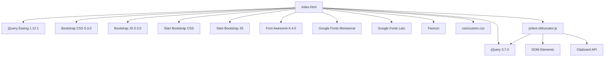

# Dependencies

## External dependencies (CDN)

| Dependency | Version | CDN URL | Purpose | Integrity |
|------------|---------|---------|---------|-----------|
| jQuery | 3.7.0 | `https://code.jquery.com/jquery-3.7.0.slim.min.js` | DOM manipulation | None |
| jQuery Easing | 1.12.1 | `https://cdnjs.cloudflare.com/ajax/libs/jquery-easing/1.12.1/jquery.easing.min.js` | Animation easing | None |
| Bootstrap CSS | 5.3.0 | `https://cdn.jsdelivr.net/npm/bootstrap@5.3.0/dist/css/bootstrap.min.css` | Layout, components | None |
| Bootstrap JS | 5.3.0 | `https://cdn.jsdelivr.net/npm/bootstrap@5.3.0/dist/js/bootstrap.bundle.min.js` | Interactive components | None |
| Start Bootstrap CSS | Latest | `https://startbootstrap.github.io/startbootstrap-freelancer/css/styles.css` | Template styling | None |
| Start Bootstrap JS | Latest | `https://startbootstrap.github.io/startbootstrap-freelancer/js/scripts.js` | Template scripts | None |
| Font Awesome | 6.4.0 | `https://use.fontawesome.com/releases/v6.4.0/js/all.js` | Icons | None |
| Google Fonts (Montserrat) | Latest | `https://fonts.googleapis.com/css?family=Montserrat:400,700` | Typography | None |
| Google Fonts (Lato) | Latest | `https://fonts.googleapis.com/css?family=Lato:400,700,400italic,700italic` | Typography | None |
| Favicon | Latest | `https://iconarchive.com/download/i106193/papirus-team/papirus-apps/preferences-desktop-user-password.ico` | Browser tab icon | None |

## Internal dependencies

| Module | Path | Depends on | Description |
|--------|------|------------|-------------|
| `index.html` | Root | All CDN assets, `css/custom.css`, `js/text-obfuscator.js` | Composition root |
| `css/custom.css` | `css/` | None | Custom styling |
| `js/text-obfuscator.js` | `js/` | jQuery (`$`), DOM elements | Obfuscation logic |

## Dependency graph

## Version pinning

| Dependency | Pinned | Update process |
|------------|--------|----------------|
| jQuery | ✅ 3.7.0 | Manual HTML edit |
| jQuery Easing | ✅ 1.12.1 | Manual HTML edit |
| Bootstrap CSS | ✅ 5.3.0 | Manual HTML edit |
| Bootstrap JS | ✅ 5.3.0 | Manual HTML edit |
| Font Awesome | ✅ 6.4.0 | Manual HTML edit |
| Start Bootstrap CSS | ❌ Latest | Manual HTML edit |
| Start Bootstrap JS | ❌ Latest | Manual HTML edit |
| Google Fonts | ❌ Latest | Automatic by Google |
| Favicon | ❌ Latest | Manual HTML edit |

## Vulnerability management

No automated vulnerability scanning. Dependencies are updated manually when maintainers choose to update versions in `index.html`.

## Licence compatibility

| Dependency | Licence | Compatible with GPL v3 |
|------------|---------|------------------------|
| jQuery | MIT | ✅ |
| jQuery Easing | BSD-3-Clause | ✅ |
| Bootstrap | MIT | ✅ |
| Start Bootstrap | MIT | ✅ |
| Font Awesome | CC BY 4.0 / SIL OFL 1.1 | ✅ (with attribution) |
| Google Fonts | SIL OFL 1.1 | ✅ |

All dependencies have permissive licences compatible with GPL v3.

## Bundle size impact

| Asset | Approximate size (gzipped) |
|-------|---------------------------|
| jQuery 3.7.0 slim | ~27 KB |
| jQuery Easing | ~3 KB |
| Bootstrap CSS | ~22 KB |
| Bootstrap JS bundle | ~18 KB |
| Start Bootstrap CSS | ~5 KB |
| Start Bootstrap JS | ~2 KB |
| Font Awesome | ~80 KB (full) |
| Google Fonts | ~10–20 KB per font |
| Custom CSS | <1 KB |
| text-obfuscator.js | ~15 KB |

Total: ~180–200 KB gzipped (varies by Font Awesome subset loading)

## References

- [Architecture](../architecture.md)
- [Integration models](../components/integration-models.md)
- [Security](../security.md)
- [Host and composition](../components/host-and-composition.md)