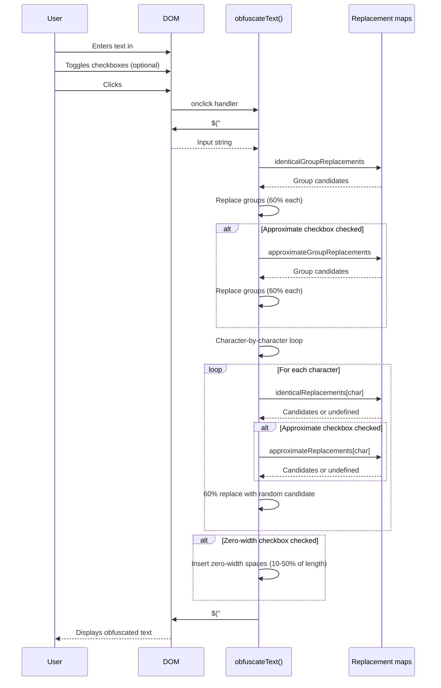

# Obfuscation flow

## Overview

Character replacement, approximate replacements, and zero-width space insertion triggered by the Obfuscate button.

## Sequence diagram



## Detailed algorithm

### Phase 1: Identical group replacements

```javascript
for (var [group, candidates] of Object.entries(identicalGroupReplacements)) {
    var replacement = group;
    if (Math.floor(Math.random() * 10) + 1 <= 6) {  // 60% chance
        var randomCandidateIndex = Math.floor(Math.random() * candidates.length);
        replacement = candidates[randomCandidateIndex];
    }
    input = input.replace(group, replacement);
}
```

- Iterates all entries in `identicalGroupReplacements`
- Each group has independent 60% replacement probability
- `String.prototype.replace()` replaces **first occurrence only**
- Replacement is a single character from the candidate string
- Order of iteration: insertion order of object properties (ES2015+)

**Example**: Input `"Hello!! World"` → `"Hello‼ World"` (if `!!` → `‼` selected)

### Phase 2: Approximate group replacements (conditional)

```javascript
if ($("#approximateCharactersCheckbox").is(':checked')) {
    for (var [group, candidates] of Object.entries(approximateGroupReplacements)) {
        var replacement = group;
        if (Math.floor(Math.random() * 10) + 1 <= 6) {
            var randomCandidateIndex = Math.floor(Math.random() * candidates.length);
            replacement = candidates[randomCandidateIndex];
        }
        input = input.replace(group, replacement);
    }
}
```

- Only executes if `#approximateCharactersCheckbox` is checked
- Same 60% probability per group
- Operates on the **already modified** input from Phase 1
- Also uses first-occurrence-only replacement

### Phase 3: Character-by-character replacements

```javascript
for (var i = 0; i < input.length; i++) {
    var character = input[i];
    var wasObfuscated = false;
    var candidates = "";

    if (identicalReplacements[character]) {
        candidates = identicalReplacements[character];
    }

    if ($("#approximateCharactersCheckbox").is(':checked') && approximateReplacements[character]) {
        candidates += approximateReplacements[character];
    }

    if (candidates != null && candidates.length > 0) {
        if (Math.floor(Math.random() * 10) + 1 <= 6) {
            var randomCandidateIndex = Math.floor(Math.random() * candidates.length);
            output += candidates[randomCandidateIndex];
            wasObfuscated = true;
        }
    }

    if (!wasObfuscated) {
        output += input[i];
    }
}
```

- Iterates each character of the modified input (after Phases 1–2)
- Builds candidate string from:
  - `identicalReplacements[character]` (always)
  - `approximateReplacements[character]` (if checkbox checked)
- 60% chance to replace with random character from combined candidates
- If no replacement, original character preserved
- Output string built incrementally

**Surrogate pair handling**: The loop iterates by UTF-16 code units (`input[i]`). Characters outside BMP (emoji, some CJK) are split into two iterations, each processed independently. This may produce unexpected results for such characters.

### Phase 4: Zero-width space insertion (conditional)

```javascript
if ($("#zeroWidthSpacesCheckbox").is(':checked')) {
    var zeroWidthCharacters = ["\u200B", "\u200C", "\u200D", "\uFEFF", "\u2060"];
    var inputLength = input.length;  // Note: uses original input length
    var minSpaces = Math.ceil(inputLength * 0.1);
    var maxSpaces = Math.floor(inputLength * 0.5);
    var spaceCount = minSpaces + Math.floor(Math.random() * (maxSpaces - minSpaces + 1));

    for (var j = 0; j < spaceCount; j++) {
        var randomPosition = Math.floor(Math.random() * (output.length + 1));
        var randomCharacter = zeroWidthCharacters[Math.floor(Math.random() * zeroWidthCharacters.length)];
        output = output.slice(0, randomPosition) + randomCharacter + output.slice(randomPosition);
    }
}
```

- Only executes if `#zeroWidthSpacesCheckbox` is checked (default: checked)
- Count: random integer between 10% and 50% of **original input length** (before any replacements)
- Positions: uniform random across current output length (grows with each insertion)
- Characters: random selection from 5 zero-width Unicode characters:
  - `U+200B` Zero Width Space
  - `U+200C` Zero Width Non-Joiner
  - `U+200D` Zero Width Joiner
  - `U+FEFF` Zero Width No-Break Space (BOM)
  - `U+2060` Word Joiner
- String slicing creates new string each iteration (O(n²) for many insertions)

### Phase 5: Output display

```javascript
$("#output").val(output);
```

- Sets the value of the readonly output field
- Triggers no additional events

## Probability model

| Stage | Probability | Independent per |
|-------|-------------|-----------------|
| Identical group replacement | 60% | Group entry |
| Approximate group replacement | 60% | Group entry |
| Character replacement | 60% | Character position |
| Zero-width space count | Uniform | 10–50% of input length |
| Zero-width character selection | Uniform | 5 characters |
| Zero-width position | Uniform | Output length + 1 |

## Determinism

- **Non-deterministic**: Every invocation produces different output for same input
- **No seed**: Uses `Math.random()` with no user-controllable seed
- **No replay**: Cannot reproduce a specific obfuscation result

## Complexity

- **Time**: O(n × m) where n = input length, m = average candidates per character
- **Space**: O(n + k) where k = zero-width spaces inserted
- **Zero-width insertion**: O(k × n) due to repeated string slicing

## Edge cases

| Input | Behaviour |
|-------|-----------|
| Empty string | Output empty; zero-width insertion inserts 0 spaces |
| Only characters without replacements | Output identical to input (plus zero-width spaces if enabled) |
| Very long input (>100k chars) | Main thread blocked; UI freezes during processing |
| Surrogate pairs (emoji) | Each code unit processed separately; likely corrupted |
| Newlines | Not in replacement maps; preserved (but input is single-line) |
| Null/undefined input | `$("#input").val()` returns `""` for empty field |

## References

- [Architecture](../architecture.md)
- [Application services](../components/application-services.md)
- [Browser state](../components/browser-state-and-localisation.md)
- [Copy to clipboard](./copy-to-clipboard.md)