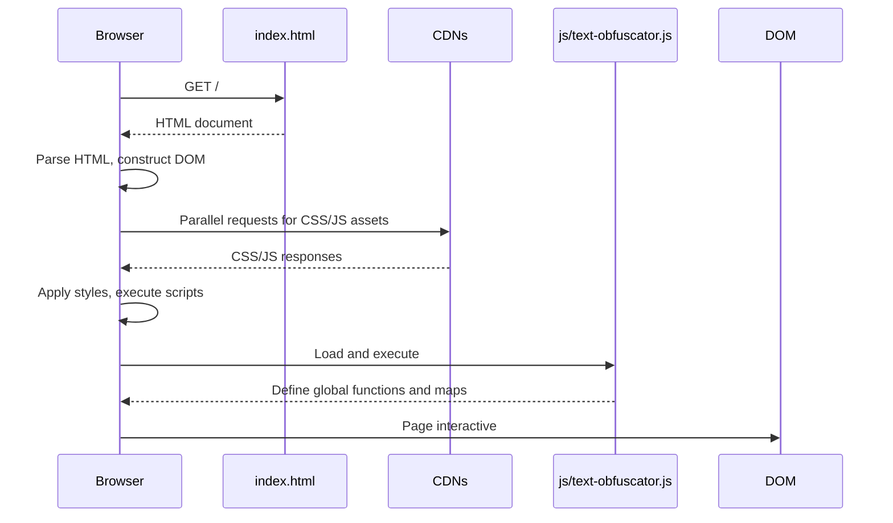

# Startup and rendering flow

## Overview

Page load, DOM construction, asset loading, and initialisation sequence.

## Sequence diagram

## Detailed steps

### 1. HTML fetch and parse

- Browser requests `index.html` from GitHub Pages
- HTML parser constructs DOM tree
- Meta tags processed (charset, viewport, description)
- Favicon request initiated

### 2. CSS asset loading (blocking)

| Asset | URL | Blocking |
|-------|-----|----------|
| Bootstrap CSS | `https://cdn.jsdelivr.net/npm/bootstrap@5.3.0/dist/css/bootstrap.min.css` | Yes |
| Start Bootstrap CSS | `https://startbootstrap.github.io/startbootstrap-freelancer/css/styles.css` | Yes |
| Custom CSS | `css/custom.css` | Yes |
| Google Fonts (Montserrat) | `https://fonts.googleapis.com/css?family=Montserrat:400,700` | Yes |
| Google Fonts (Lato) | `https://fonts.googleapis.com/css?family=Lato:400,700,400italic,700italic` | Yes |

CSS is render-blocking. Page remains blank until all CSS loads and applies.

### 3. JavaScript asset loading (mixed blocking)

| Asset | URL | Blocking | Notes |
|-------|-----|----------|-------|
| jQuery | `https://code.jquery.com/jquery-3.7.0.slim.min.js` | Yes | In `<head>`, no `defer`/`async` |
| jQuery Easing | `https://cdnjs.cloudflare.com/ajax/libs/jquery-easing/1.12.1/jquery.easing.min.js` | Yes | In `<head>` |
| Bootstrap JS | `https://cdn.jsdelivr.net/npm/bootstrap@5.3.0/dist/js/bootstrap.bundle.min.js` | Yes | In `<head>` |
| Font Awesome | `https://use.fontawesome.com/releases/v6.4.0/js/all.js` | No | `crossorigin="anonymous"`, async |
| Start Bootstrap JS | `https://startbootstrap.github.io/startbootstrap-freelancer/js/scripts.js` | Yes | At `</body>` |
| text-obfuscator.js | `js/text-obfuscator.js` | Yes | At `</body>` |

Scripts in `<head>` without `defer`/`async` block parsing. Scripts at `</body>` execute after DOM construction.

### 4. Script execution order

1. jQuery executes → defines `$` globally
2. jQuery Easing executes → extends `$.easing`
3. Bootstrap JS executes → initialises Bootstrap components
4. Font Awesome executes (async) → registers icons
5. DOMContentLoaded fires
6. Start Bootstrap `scripts.js` executes → smooth scroll for `js-scroll-trigger`
7. `text-obfuscator.js` executes → defines:
   - `identicalGroupReplacements`
   - `approximateGroupReplacements`
   - `identicalReplacements`
   - `approximateReplacements`
   - `obfuscateText()`
   - `copyText()`
   - `fallbackCopy()`

### 5. Interactive readiness

After step 7, the page is fully interactive:
- Input field accepts text
- Checkboxes respond to clicks
- Buttons execute their `onclick` handlers
- All replacement maps are in memory

## Timing characteristics

- **Critical path**: HTML → CSS (slowest CDN) → JS in `<head>` → DOMContentLoaded → JS at `</body>`
- **Typical load time**: 500–2000 ms depending on CDN latency and cache state
- **Offline after first load**: All assets cached by browser; subsequent loads near-instant

## Failure modes

| Failure point | Symptom | Recovery |
|---------------|---------|----------|
| HTML fetch fails | Browser error page | Retry / check network |
| CSS CDN fails | Unstyled/broken layout | Refresh / cached version |
| jQuery fails | `ReferenceError: $ is not defined` on button click | Refresh / check CDN status |
| text-obfuscator.js fails | Buttons do nothing | Refresh / check file exists |
| Font Awesome fails | Missing icons | No functional impact |
| Google Fonts fails | Fallback fonts used | No functional impact |

## References

- [Architecture](../architecture.md)
- [Host and composition](../components/host-and-composition.md)
- [Presentation](../components/presentation.md)
- [Integration models](../components/integration-models.md)