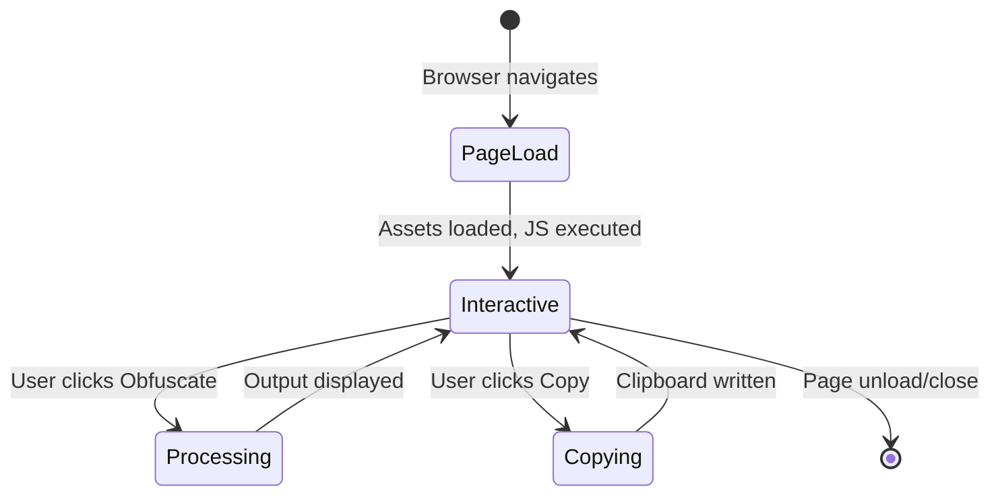

# State and persistence

## State management

The application uses **no state management library, store, or cache**. All state is transient DOM state.

## State locations

| State | Location | Lifetime | Persistence |
|-------|----------|----------|-------------|
| Input text | `#input` value | Page session | None |
| Output text | `#output` value | Page session | None |
| Approximate checkbox | `#approximateCharactersCheckbox` checked | Page session | None |
| Zero-width checkbox | `#zeroWidthSpacesCheckbox` checked | Page session | None |
| Replacement maps | Global JS variables | Page session | None (reloaded each visit) |

## Stores

None. No Redux, Vuex, MobX, Context API, or custom store.

## Caches

None. No HTTP caching beyond browser default for static assets. No application-level caching.

## Migrations

Not applicable. No persistent schema or data to migrate.

## State transitions

## Offline state

After initial load, all state is local. Application functions fully offline.

## References

- [Architecture](../architecture.md)
- [Browser state](../components/browser-state-and-localisation.md)
- [Data model](../data-model.md)
- [Obfuscation flow](../flows/obfuscation.md)